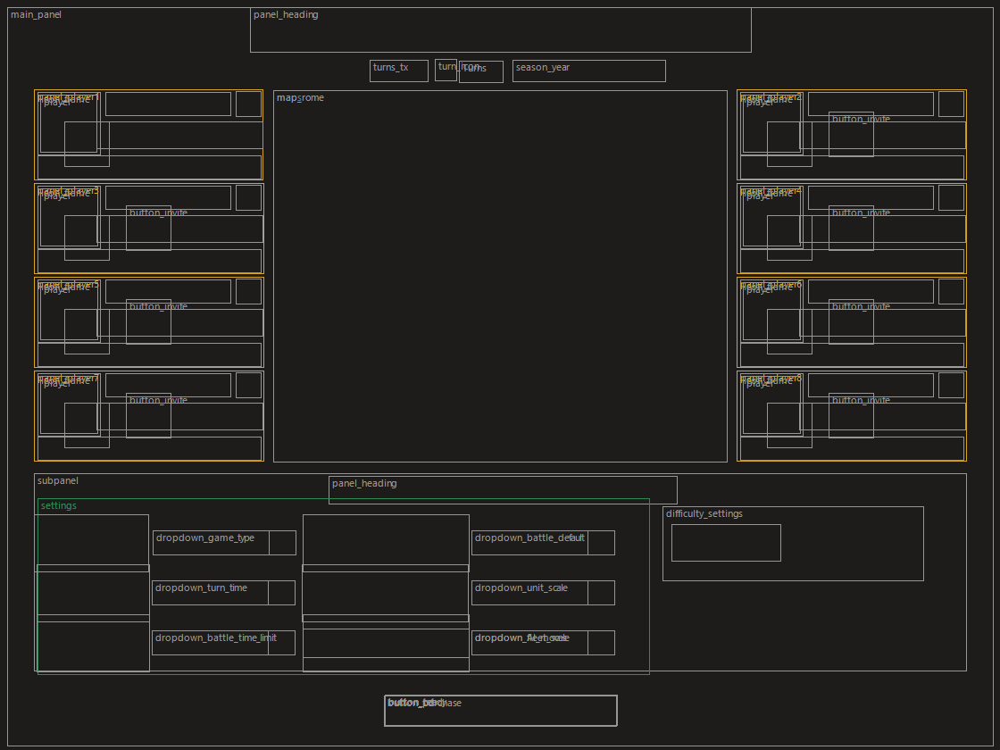

# Rome II: 8-player co-op campaign (experimental)
**by Tasman Modding**

The Rome II version of the [Shogun 2 8-player co-op mod](https://github.com/TasmanModding/Shogun2-8Player-Coop).

## What it does
| | |
|---|---|
| **Up to 8 players** | The multiplayer campaign lobby has 8 player slots (four on each side of the map), titled "Eight Player Campaign", and the host session accepts 8 players. |
| **Start with 2 to 8 players** | The original game only starts a multiplayer campaign when exactly 2 players have joined. Now it starts with any number from 2 to 8, once everyone is ready. |
| **Players fill the slots in order** | The host is player 1, the next player to join is player 2, and so on. (With 8 slots the original game put the host in slot 7, and the lobby broke.) |
| **Kick and invite buttons** | Every slot's kick button works and kicks that player. The original only showed one kick button, and it always kicked the first player in the list. Every empty slot's invite button opens the friends list (the host sees them; the original game only wired one). |
| **Lobby crash fixes** | The lobby kept some player data in space for only 2 players. With more players, joining, picking a faction or leaving overwrote other lobby data: the host's panel and the campaign map vanished, and the game crashed on the next screen. Fixed in four places. |
| **Small crash reports** | When the game crashes it saves a `.mdmp` crash file in `%APPDATA%\The Creative Assembly\Rome2\crash_report`. The original game copied a large part of its memory into it (about 68 MB per crash). Now it keeps only what's needed to find the cause (well under 1 MB), small enough to attach to a Discord message or a GitHub issue. |
| **Mod check** | The installer prints a MATCH CODE. The same code on every PC means everyone has the same mod files. |

**Steam Workshop page** (the 8-slot lobby only; the full mod is the download below): https://steamcommunity.com/sharedfiles/filedetails/?id=3827019251

## Community
Join the **Tasman Modding Discord** for help, finding players, bug reports and updates: https://discord.gg/vt4JbH79Np

## Install / uninstall
1. Everyone closes Rome II.
2. Double-click **`Install.bat`**. It finds the game in your Steam folders. If yours is somewhere else, run
   `powershell -ExecutionPolicy Bypass -File install.ps1 -GamePath "D:\...\Total War Rome II"`.
3. Start Rome II from Steam. If the launcher warns about an "out-of-date mod", click **Ignore this warning** ("Disable" would turn the 8-slot lobby off).
4. Host a multiplayer campaign: **Multiplayer > Campaign > Host Campaign**.

**Updating:** every new version is published on [GitHub](https://github.com/TasmanModding/Rome2-8Player-Coop/releases/latest). Steam Workshop can only share `.pack` files, so it can't update the engine part of the mod for you. Download the newest zip, unzip it and run `Install.bat`: it replaces the old version. New versions are announced in the [Discord](https://discord.gg/vt4JbH79Np). Update together with your friends, since everyone needs the same version.

**`Uninstall.bat`** puts everything back. Steam's "Verify integrity of game files" also restores the original DLL.

At the end the installer prints a **MATCH CODE** (8 letters/digits). Everyone compares it: the same code means the same mod files.

Everyone must also end up with the same two hashes, or they can't join each other. The installer prints them:

| File | SHA-256 |
|---|---|
| `empire.retail.dll` | `6C39A752CD0C06D0811AEC55353FF2DA9BB52F3A9BB153EEE52FD17F16E39C1A` |
| `data\eightplayer_coop.pack` | `E3D5CC8B5885C3D06E719A4EEECF5AA0121CB003BC86C02A295989B27626A689` |

## Before you play
- This mod changes the game's engine file. Stay sensible: play with friends, and use a spare account if you want to be extra safe.
- It only works on the current Steam version of the game; the installer refuses anything else.
- A campaign can only have as many players as it has co-op factions: Grand Campaign 36, Imperator Augustus 10, Empire Divided 10, Rise of the Republic 9, Hannibal at the Gates 5, Wrath of Sparta 4, Caesar in Gaul 2. Start with the Grand Campaign.
- To give desyncs fewer chances: everyone has **no other mods** enabled and the **same game version**, and **only the host saves**.

## If something goes wrong
| Problem | Fix |
|---|---|
| Lobby shows only 2 slots | The installer didn't run, or the launcher disabled the mod: run `Install.bat` again and click "Ignore this warning" in the launcher. |
| Can't join each other | Compare MATCH CODEs; everyone runs the same version's `Install.bat`. |
| "Out of sync" popup on the map | Press OK on the game's resync popup, on every PC. |
| A game crashed | Send the newest `.mdmp` file from `%APPDATA%\The Creative Assembly\Rome2\crash_report` (paste that path into the Windows Explorer address bar; since v1.3 the file is well under 1 MB). Everyone quits; the host loads the newest save. |

## Test plan
Please report the step where it breaks, what you saw, and the newest `.mdmp` from `%APPDATA%\The Creative Assembly\Rome2\crash_report` if the game crashed.
1. Host alone: the lobby shows 8 slots (four each side of the map), your panel and the campaign map.
2. Players 2–8 join: each lands in the next slot with name and faction. The host's kick button on a slot kicks that player.
3. A player in slot 3 or higher leaves the lobby, and someone joins again: no crash.
4. Everyone picks a different faction and readies up; the campaign starts for everyone (with 3+ players too), and every human faction is human-controlled.
5. Play a few turns: the turn passes through every human.
6. One human fights a battle against the AI and the others watch: everyone stays in the game.
7. Head-to-head, 3+ players: player 1 attacks player 3 (a field battle, then a siege). The others stay in the game.
8. Co-op: in Diplomacy, are all the human players co-op allies, or only players 1 and 2?
9. Save, quit, resume.

## v1.3: small crash reports
- **Crash files are now well under 1 MB** instead of about 68 MB. The game's crash file used to hold a copy of a large part of its memory. Now it keeps the crash location, every thread's stack and the list of loaded files: everything needed to find the cause. Crash files from before v1.3 can be deleted from `%APPDATA%\The Creative Assembly\Rome2\crash_report` to free up space.

**Fixed in v1.2:** the campaign starts with 2 to 8 players (the original only started with exactly 2); leaving the lobby no longer crashes.
**Fixed in v1.1:** the host's panel and the campaign map were missing in the 8-slot lobby; players now fill the slots in order (the host was put in slot 7); invite buttons on every empty slot.

If something goes wrong, report it in the [Discord](https://discord.gg/vt4JbH79Np), [open an issue](https://github.com/TasmanModding/Rome2-8Player-Coop/issues/new?template=crash_report.md) or comment on the [Steam Workshop page](https://steamcommunity.com/sharedfiles/filedetails/?id=3827019251), with: how many players, co-op or head-to-head, who was in the battle, what happened on whose screen and when, your MATCH CODE, and the newest `.mdmp` file from `%APPDATA%\The Creative Assembly\Rome2\crash_report`.

## Known limitations - please report what you see
The game was built for 2 players, so with 3–8 players some parts haven't been tested in real games yet:
- **Battles between humans outside slots 1 and 2** (for example player 1 attacking player 3) haven't been tested. In Shogun 2 this crashed until it was fixed; Rome II's battle code is different, so it needs a real test and a crash report if it fails.
- Co-op alliances for players 3–8, reinforcements joining battles, turn order, and the end of a 3+ player campaign haven't been tested.
- Battle results for players who weren't in a battle haven't been checked.
- Multiplayer save names still only list two players.
- Resuming a save needs the same players.
- More players means more chances of a desync, and the game always waits for the slowest connection.

## Files
| Path | What |
|---|---|
| `Install.bat`, `Uninstall.bat`, `install.ps1` | installer / uninstaller |
| `build_lobby_layout.ps1` | builds the 8-slot lobby from your own copy of the game |
| `lib\Patcher.cs` | builds the patched engine DLL (checks the original first) |
| `lib\Layout86.cs`, `lib\PackTools.cs` | read/write Rome II UI layouts (Version086) and `.pack` files |
| `verify_load.ps1` | loads a patched DLL with Windows' loader (no code runs) and checks every patch |
| `preview\` | schematic of the lobby (boxes only, no game artwork) |
| `NOTES.md` | reverse-engineering notes |

**Download:** get the zip from the [Releases page](https://github.com/TasmanModding/Rome2-8Player-Coop/releases/latest). It contains no game files: the installer builds the mod from your own copy of the game.
